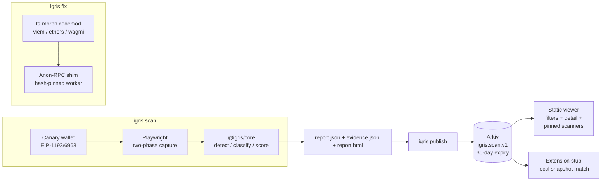

# Igris

**Lighthouse for dapp privacy: scan, explain, fix, publish.**

Igris shows what a dApp leaks about its users: which third parties learn a
user's **wallet address**, which learn their **IP before they click
anything**, and which **RPC providers** can link the two — with evidence for
every claim.

- **Provable, not vibes**: the scanner opens the dApp in an isolated browser
  with a throwaway _canary_ wallet (EIP-1193/EIP-6963) that never existed
  before the scan, connects it the way a user would (RainbowKit, ConnectKit,
  Reown AppKit, Privy, Dynamic and custom modals), and records every request.
  Any request carrying the canary address (14+ encodings, hashed forms
  flagged separately) is a leak with content-addressed evidence attached.
- **Readable by anyone**: a local web app turns each scan into a plain
  report — _who learned what_, findings with evidence, the score ledger and
  an in-browser re-check of the evidence hashes. The app itself makes zero
  third-party requests (enforced by an e2e test).
- **Fixable, not just gradable**: `igris fix` rewrites viem/ethers/wagmi RPC
  setups to route reads through the Ethereum Foundation's
  [Anon-RPC](https://ethereum.github.io/anon-rpc/), and a rescan proves the
  before/after.
- **A registry nobody operates** (built, not yet live): results become Arkiv
  entities signed by the scanner node that measured them, with mandatory
  expiry. **No entities have been published yet** — see
  [Registry](#registry-arkiv).

Project status and acceptance criteria: [docs/ROADMAP.md](docs/ROADMAP.md) ·
engineering log: [docs/ENGINEERING_LOG.md](docs/ENGINEERING_LOG.md).

## Quickstart

```bash
pnpm install
pnpm exec playwright install chromium chromium-headless-shell
pnpm demo        # offline end-to-end story in ~1 minute (see below)
```

Run the web app (scanner API + UI, both on your machine):

```bash
pnpm -s exec tsx apps/api/src/index.ts   # scanner API on :3001 (egress public-only)
pnpm --filter @igris/app dev             # web app on http://localhost:5180
```

Scan a real dapp from the command line:

```bash
pnpm igris scan https://app.example.org --fail-under 80
```

Outputs to `igris-out/`: `report.json` (Report v2), `evidence.json` (the
evidence bundle as canonical bytes, so `shasum -a 256 evidence.json` matches
the hash in the report) and a self-contained `report.html`. Exit codes are
0 / 1 (below threshold) / 2 (scan error) / 3 (bad args), for CI. Formats and
hashing: [docs/CONTRACTS.md](docs/CONTRACTS.md).

```bash
pnpm igris verify igris-out/report.json   # schemas, evidence hash, references
```

Patch a repo:

```bash
pnpm igris fix path/to/dapp            # dry run: unified diff + manual notes
pnpm igris fix path/to/dapp --write    # apply (running twice is a no-op)
```

Publish and query (local file or Arkiv testnet):

```bash
pnpm igris publish igris-out/report.json --registry local
pnpm igris query --registry local --min-score 50 --class analytics
pnpm igris snapshot --registry local --out snapshot.json
```

Publishing to Arkiv (Rabdi testnet) is signed by this machine's own scanner
key. Keys are never read from environment variables:

```bash
pnpm igris scanner init --name my-scanner   # new key in ~/.igris, bound to this machine
# fund the printed address at https://hub.arkiv.network/faucet, then:
pnpm igris publish igris-out/report.json
```

`pnpm demo` runs: scan the deliberately leaky fixture → `igris fix` diff →
scan the fixed fixture → publish both to a local registry → query it back →
snapshot → scan **our own registry viewer** — and prints the before/after:

| dapp                           | score | RPC leaks | usesAnonRpc |
| ------------------------------ | ----- | --------- | ----------- |
| leaky-dapp (before)            | 0     | 1         | false       |
| leaky-dapp (after `igris fix`) | 17    | 0         | **true**    |

(The remaining 17-score leaks are the planted analytics/error-monitor/pixel
leaks — `igris fix` honestly fixes only RPC reads.)

## Architecture



Details: [docs/PROJECT_GUIDE.md](docs/PROJECT_GUIDE.md) (Complete plain-English guide & deployment),
[docs/ARCHITECTURE.md](docs/ARCHITECTURE.md),
[docs/METHODOLOGY.md](docs/METHODOLOGY.md),
[docs/SCORING.md](docs/SCORING.md),
[docs/ANON_RPC_NOTES.md](docs/ANON_RPC_NOTES.md),
[arkiv/](arkiv/). Judges: [docs/JUDGES.md](docs/JUDGES.md) verifies every
claim in under 5 minutes.

## CROPS

Lead property: **Privacy** — IGRIS exists to show, with evidence, what a
dApp leaks about its users (wallet address, IP, RPC exposure) and to remove
the RPC leak. Each line below was checked against the code on branch
`mvp-web-app` (2026-11-06); open gaps are named.

- **C — Censorship resistance.** IGRIS is software you run, not a service
  you depend on: the CLI and the web app run the same scanner on your own
  machine, with no account, server or API key of ours. The only things we
  could control are (1) an _optional_ hosted scanner API — not deployed
  (local/Docker only; a public deployment is gated on running Chromium with
  its own sandbox, ROADMAP P4-6) — whose absence changes nothing, because
  `pnpm igris scan` and the local web app are the same code; and (2) the
  default Arkiv endpoint in the viewer, which is a user setting. Registry
  entries are Arkiv entities owned by whichever scanner keys publish them:
  nobody needs our permission to publish or read, and the viewer's snapshot
  mode and the CLI keep working if the Arkiv testnet is down or reset. The
  third-party database is a file in this repo (`data/third-parties.json`),
  every entry with a cited source.
- **O — Open source.** MIT ([LICENSE](LICENSE)). Everything builds and runs
  from this repository alone with no secrets: `pnpm install`,
  `pnpm exec playwright install chromium` (the browser binary is downloaded
  from Playwright's CDN), then `pnpm demo` runs fully offline.
- **P — Privacy.** What each party learns:
  - _the scanned dApp and its third parties_: a throwaway canary address
    (never a real user's), plus the **scanning machine's IP address** and a
    headless-Chromium fingerprint. Scanning is a visit; run it behind a VPN
    if your IP matters. Scans from the web app/API are egress-filtered to
    public addresses; CLI scans are not filtered;
  - _RPC providers_: nothing from the scanner itself — wallet reads are
    answered locally by a stub (`--live-reads` is an explicit opt-in);
  - _the IGRIS web app_: makes **zero third-party requests** — fonts are
    self-hosted, there are no trackers or analytics, and
    `apps/app/e2e/no-third-party.e2e.ts` fails the build if any page loads
    anything from another origin;
  - _the scanner API (your machine)_: stores a **scan history** (submitted
    URLs, reports, evidence) in `.igris-data/` on that machine; nothing is
    published. It has **no authentication**: anyone who can reach the port
    can list and read those scans, which is why it is meant for local use.
    It logs no client IPs; rate-limit keys are salted hashes kept in memory;
  - _the Arkiv RPC_: a publisher's IP on writes; a viewer's IP and query
    filters on reads (configurable endpoint; snapshot mode makes zero
    requests, e2e-tested);
  - _Anon-RPC relay/exit_ (dApps patched by `igris fix`): the RPC requests,
    instead of the RPC provider seeing the user —
    [docs/ANON_RPC_NOTES.md](docs/ANON_RPC_NOTES.md).
- **S — Security.** The canary key is generated in memory for each scan,
  never funded and discarded afterwards. The canary wallet **signs**
  `personal_sign` and `eth_signTypedData_v4` requests (so sign-in flows
  complete and their traffic is observed; the connect engine clicks an
  in-dialog "Sign" confirmation once) and **rejects** `eth_sendTransaction`,
  `eth_signTransaction`, `eth_sendRawTransaction` and `eth_sign`. A scanner's
  publishing key is created by `igris scanner init` in `~/.igris` (mode 0600,
  bound to that machine) and is never read from environment variables.
  Registry data is treated as hostile: every row is schema-validated and
  every rendered value escaped. Every finding carries content-addressed
  evidence; reports and evidence bundles verify by hash in the CLI
  (`igris verify`), in the API on every read, and again in your browser.
  Trust assumptions: a registry entity is an _attestation by its owner
  address_, not a fact — you choose which scanners to pin; a score covers
  only what a browser can observe (server-side sharing is invisible).
  Open gaps: the evidence bundle is not yet published to Arkiv, so a
  registry entity's hashes cannot yet be checked by a third party (ROADMAP
  P2-3); Chromium runs without its own sandbox in the API container
  (ROADMAP P4-6); the scanner API has no authentication (local use only).

## Where the blockchain is used

- **Ethereum, inside every scan.** The canary wallet is a real EIP-1193 /
  EIP-6963 provider backed by a fresh secp256k1 key (viem). dApps discover it
  like MetaMask or Rabby, request its accounts, read chain state through it
  (answered by a local stub, so the scanner itself leaks nothing) and ask it
  to sign sign-in messages. Leak detection then searches every request for
  that address in 14+ encodings (checksummed, lowercase, ABI-padded inside
  `eth_call` data, keccak/sha256-hashed, …). Unknown hosts that receive only
  Ethereum JSON-RPC are recognised as RPC providers by their traffic.
- **Anon-RPC.** IGRIS detects whether a dApp routes reads through
  [Anon-RPC](https://ethereum.github.io/anon-rpc/) (whose worker is pinned by
  an on-chain specifier contract) and `igris fix` patches a dApp's
  viem/ethers/wagmi setup to do so.
- **Arkiv (registry).** Each scanner node has its own key (`igris scanner
init`). `igris publish` writes a signed, expiring `igris.scan.v1` entity
  to Arkiv's Rabdi testnet (chain 7794095): hostname, score, leak classes,
  the canonical report hash and the evidence hash. Anyone can query it
  without us; consumers decide which scanner addresses they trust. Writing
  requires a funded key — not done yet (see below).

## Registry (Arkiv)

- Schema `igris.scan.v1` on Arkiv's Rabdi testnet (chain 7794095) — see
  [arkiv/schema.md](arkiv/schema.md). Schema v2 (immutable entities,
  published evidence, history) is ROADMAP P2.
- **Published entities: none yet.** Writing requires a funded scanner key
  (one per scanner node, never shared) — ROADMAP P2-1, BLOCKED on a human
  funding step. No scanner address is listed here until it has actually
  written entities.
- The read path works today against the live testnet (it returns zero rows):

```bash
pnpm igris query --min-score 0 --limit 10
# or raw JSON-RPC from anywhere:
curl -s https://rpc.rabdi.db-chain.testnet.arkiv.network --json \
  '{"jsonrpc":"2.0","id":1,"method":"arkiv_query","params":["arkiv.schema = str('\''igris.scan.v1'\'') ORDER BY $key ASC",{"select":{"key":true,"owner":true,"attributes":true},"limit":"0xa"}]}'
```

## Limitations (honest ones)

A scan whose page never loaded (or returned an HTTP error) has **no
score** and cannot be published. A scan whose wallet never connected is
labelled **partial**: its score covers only the pre-connect phase.
A score of 100 means "nothing detectable", not "nothing wrong": server-side
forwarding, obfuscated/encrypted exfiltration, WalletConnect-relayed flows
and deep interaction paths are out of scope — the full list with reasoning is
in [docs/METHODOLOGY.md](docs/METHODOLOGY.md). Scoring is a documented
heuristic ([docs/SCORING.md](docs/SCORING.md)), not an audit. A real funded
Arkiv publish (BLOCKED), a real-browser extension run and a live Anon-RPC
round-trip are still **UNVERIFIED** — see [STATUS.md](STATUS.md).

## License

MIT — [LICENSE](LICENSE).
