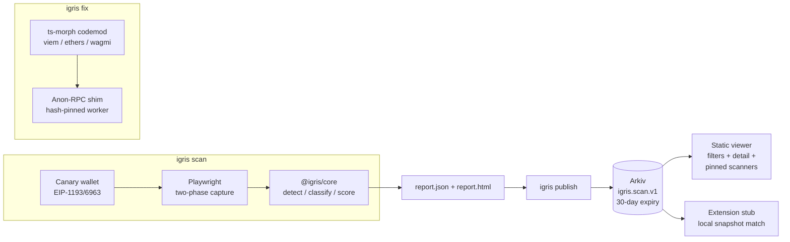

# Igris

**Lighthouse for dapp privacy: scan, explain, fix, publish.**

Igris tells dapp developers and users which third parties learn a user's
wallet address — and which learn their IP even without an address.

- **Provable, not vibes**: the scanner's mock wallet exposes a throwaway
  *canary* address that never existed before the scan; any captured request
  containing it (14+ encodings, hashed forms flagged separately) is a leak
  with evidence attached.
- **Fixable, not just gradable**: `igris fix` rewrites viem/ethers/wagmi RPC
  setups to route reads through the Ethereum Foundation's
  [Anon-RPC](https://ethereum.github.io/anon-rpc/), and a rescan proves the
  before/after.
- **A registry nobody operates**: results are signed Arkiv entities with
  mandatory expiry; a static viewer queries them with filters. No server, no
  database, no API keys of ours.

## Quickstart

```bash
pnpm install
pnpm exec playwright install chromium chromium-headless-shell
pnpm demo        # offline end-to-end story in ~1 minute (see below)
```

Scan a real dapp:

```bash
pnpm igris scan https://app.example.org --fail-under 80
```

Outputs `igris-out/report.json` + a self-contained `report.html`; exit codes
0 / 1 (below threshold) / 2 (scan error) / 3 (bad args) for CI. Patch a repo:

```bash
pnpm igris fix path/to/dapp            # dry run: unified diff + manual notes
pnpm igris fix path/to/dapp --write    # apply (running twice is a no-op)
```

Publish and query (local file or Arkiv testnet):

```bash
pnpm igris publish igris-out/report.json --registry local
pnpm igris query --registry local --min-score 50 --class analytics
pnpm igris snapshot --registry local --out snapshot.json
# Arkiv (Rabdi testnet): set ARKIV_PRIVATE_KEY (see .env.example), drop --registry local
```

`pnpm demo` runs: scan the deliberately leaky fixture → `igris fix` diff →
scan the fixed fixture → publish both to a local registry → query it back →
snapshot → scan **our own registry viewer** — and prints the before/after:

| dapp | score | RPC leaks | usesAnonRpc |
| --- | --- | --- | --- |
| leaky-dapp (before) | 0 | 1 | false |
| leaky-dapp (after `igris fix`) | 17 | 0 | **true** |

(The remaining 17-score leaks are the planted analytics/error-monitor/pixel
leaks — `igris fix` honestly fixes only RPC reads.)

## Architecture



Details: [docs/ARCHITECTURE.md](docs/ARCHITECTURE.md),
[docs/METHODOLOGY.md](docs/METHODOLOGY.md),
[docs/SCORING.md](docs/SCORING.md),
[docs/ANON_RPC_NOTES.md](docs/ANON_RPC_NOTES.md),
[arkiv/](arkiv/). Judges: [docs/JUDGES.md](docs/JUDGES.md) verifies every
claim in under 5 minutes.

## CROPS

How Igris holds up against the EF Mandate's non-negotiables
(["censorship resistant, open source, private, and secure"](https://blog.ethereum.org/2026/03/13/ef-mandate)):

- **C — Censorship Resistance.** We control nothing users depend on: the CLI
  runs locally, the viewer is a static build anyone can host, and the
  registry is Arkiv entities owned by whoever publishes them. If we and our
  infra disappear, everything keeps working from a clone of this repo; other
  scanners publish to the same schema without asking anyone.
- **O — Open Source and Free.** MIT, no black boxes: a user can clone, build,
  test and run everything from this repo alone, offline, with no secrets, in
  under 10 minutes (`pnpm install && pnpm demo`). Forkable by design.
- **P — Privacy.** What each party learns: a *scanned dapp's* third parties
  receive only a worthless throwaway canary. The *scanner* sends nothing
  anywhere by default (wallet reads are stubbed; `--live-reads` is an
  explicit opt-in). The *Arkiv RPC* learns the publisher's IP on writes and a
  viewer-user's IP on reads — so the endpoint is user-configurable and a
  fully offline snapshot mode exists. The *Anon-RPC relay/exit* of a patched
  dapp sees the RPC requests instead of the RPC provider seeing the user —
  trade-offs stated in [docs/ANON_RPC_NOTES.md](docs/ANON_RPC_NOTES.md). The
  extension stub never queries per visited site.
- **S — Security.** The canary wallet rejects `eth_sendTransaction`/`eth_sign`
  (code 4001) and its throwaway key never leaves the scanner process. No
  funds, no custody, no secrets in entities. Trust assumptions are explicit:
  a registry entity is an attestation by its scanner address, verified
  against pinned scanners and bound to its exact report by sha256. Minimal
  dependencies (stdlib argv parsing, hand-rolled diff verified against
  `git apply`), everything pinned exactly.

## Registry (Arkiv)

- Schema `igris.scan.v1` on the Rabdi testnet (chain 7794095) — see
  [arkiv/schema.md](arkiv/schema.md) for attributes, expiry rationale and the
  trust model.
- Scanner address that wrote the public entities: **TODO(human)** — fund a
  key ([.env.example](.env.example), faucet: https://hub.arkiv.network/faucet)
  and run `pnpm igris publish examples/leaky/report.json`, then paste the
  address printed as `scanner:` here and pin it in the viewer's default list
  (`DEFAULT_PINNED` in apps/web/src/main.ts).
- A runnable query (works once entities exist; read path verified live):

```bash
pnpm igris query --min-score 0 --limit 10
# or raw JSON-RPC from anywhere:
curl -s https://rpc.rabdi.db-chain.testnet.arkiv.network --json \
  '{"jsonrpc":"2.0","id":1,"method":"arkiv_query","params":["arkiv.schema = str('\''igris.scan.v1'\'') ORDER BY $key ASC",{"select":{"key":true,"owner":true,"attributes":true},"limit":"0xa"}]}'
```

## Limitations (honest ones)

A score of 100 means "nothing detectable", not "nothing wrong": server-side
forwarding, obfuscated/encrypted exfiltration, WalletConnect-relayed flows
and deep interaction paths are out of scope — the full list with reasoning is
in [docs/METHODOLOGY.md](docs/METHODOLOGY.md). Scoring is a documented
heuristic ([docs/SCORING.md](docs/SCORING.md)), not an audit. A real funded
Arkiv publish and a real-browser extension run are still
**UNVERIFIED** — see [STATUS.md](STATUS.md) for exact repro steps.

## License

MIT — [LICENSE](LICENSE).
