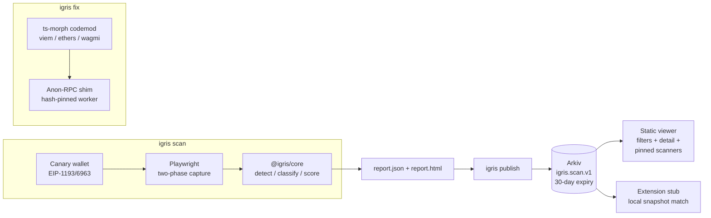

# Igris

**Lighthouse for dapp privacy: scan, explain, fix, publish.**

Igris tells dapp developers and users which third parties learn a user's
wallet address — and which learn their IP even without an address.

- **Provable, not vibes**: the scanner's mock wallet exposes a throwaway
  _canary_ address that never existed before the scan; any captured request
  containing it (14+ encodings, hashed forms flagged separately) is a leak
  with evidence attached.
- **Fixable, not just gradable**: `igris fix` rewrites viem/ethers/wagmi RPC
  setups to route reads through the Ethereum Foundation's
  [Anon-RPC](https://ethereum.github.io/anon-rpc/), and a rescan proves the
  before/after.
- **A registry nobody operates** (designed, not yet live): results become
  Arkiv entities signed by the scanner that measured them, with mandatory
  expiry; a static viewer queries them with filters. **No entities have been
  published yet** — see [Registry](#registry-arkiv).

Project status and acceptance criteria: [docs/ROADMAP.md](docs/ROADMAP.md) ·
engineering log: [docs/ENGINEERING_LOG.md](docs/ENGINEERING_LOG.md).

## Quickstart

```bash
pnpm install
pnpm exec playwright install chromium chromium-headless-shell
pnpm demo        # offline end-to-end story in ~1 minute (see below)
```

Scan a real dapp:

```bash
pnpm igris scan https://app.example.org --fail-under 80
```

Outputs `igris-out/report.json` + a self-contained `report.html`; exit codes
0 / 1 (below threshold) / 2 (scan error) / 3 (bad args) for CI. Patch a repo:

```bash
pnpm igris fix path/to/dapp            # dry run: unified diff + manual notes
pnpm igris fix path/to/dapp --write    # apply (running twice is a no-op)
```

Publish and query (local file or Arkiv testnet):

```bash
pnpm igris publish igris-out/report.json --registry local
pnpm igris query --registry local --min-score 50 --class analytics
pnpm igris snapshot --registry local --out snapshot.json
# Arkiv (Rabdi testnet): set ARKIV_PRIVATE_KEY (see .env.example), drop --registry local
```

`pnpm demo` runs: scan the deliberately leaky fixture → `igris fix` diff →
scan the fixed fixture → publish both to a local registry → query it back →
snapshot → scan **our own registry viewer** — and prints the before/after:

| dapp                           | score | RPC leaks | usesAnonRpc |
| ------------------------------ | ----- | --------- | ----------- |
| leaky-dapp (before)            | 0     | 1         | false       |
| leaky-dapp (after `igris fix`) | 17    | 0         | **true**    |

(The remaining 17-score leaks are the planted analytics/error-monitor/pixel
leaks — `igris fix` honestly fixes only RPC reads.)

## Architecture



Details: [docs/PROJECT_GUIDE.md](docs/PROJECT_GUIDE.md) (Complete plain-English guide & deployment),
[docs/ARCHITECTURE.md](docs/ARCHITECTURE.md),
[docs/METHODOLOGY.md](docs/METHODOLOGY.md),
[docs/SCORING.md](docs/SCORING.md),
[docs/ANON_RPC_NOTES.md](docs/ANON_RPC_NOTES.md),
[arkiv/](arkiv/). Judges: [docs/JUDGES.md](docs/JUDGES.md) verifies every
claim in under 5 minutes.

## CROPS

Lead property: **Privacy** — IGRIS exists to show, with evidence, who learns
a dapp user's address and IP, and to remove the RPC leak. Checked against the
code on branch `p0-integrity`; open gaps are named, not hidden.

- **C — Censorship resistance.** What we control that users depend on: (1)
  the _optional_ scanner API — local/Docker-only today; if it disappears or
  refuses you, `pnpm igris scan` runs the identical scanner on your machine;
  (2) the viewer's default Arkiv endpoint, which is a user setting. The
  registry is Arkiv entities owned by whichever scanner keys publish them;
  nobody needs our permission to publish under the same schema. Arkiv's
  testnet itself is outside our control: if it is down or reset, the viewer's
  snapshot mode and the CLI keep working.
- **O — Open source.** MIT ([LICENSE](LICENSE)). Everything builds and runs
  from this repo alone, offline, with no secrets: `pnpm install && pnpm demo`.
- **P — Privacy.** What each party learns:
  - _the scanned dapp's third parties_: a throwaway canary address, never a
    real user;
  - _the scanner (CLI)_: sends nothing by default — wallet reads are answered
    locally (`--live-reads` is an explicit opt-in);
  - _the optional scanner API_: the URL you submit and your IP address. It
    stores no results and logs no client IPs; rate-limit keys are salted
    hashes held in memory only;
  - _the Arkiv RPC_: a publisher's IP on writes; a viewer's IP and query
    filters on reads — the endpoint is configurable, and snapshot mode makes
    zero requests (e2e-tested);
  - _Anon-RPC relay/exit_ (dapps patched by `igris fix`): the RPC requests,
    instead of the RPC provider seeing the user —
    [docs/ANON_RPC_NOTES.md](docs/ANON_RPC_NOTES.md).
    The client has no trackers or analytics.
- **S — Security.** The canary wallet rejects `eth_sendTransaction` /
  `eth_sign` and its key never leaves the scanner process. A scanner's
  publishing key stays on the operator's machine (`.env`, gitignored,
  excluded from Docker builds). Registry data is treated as hostile: every
  row is schema-validated and every rendered value escaped. Hosted scans are
  egress-filtered (public addresses, ports 80/443, DNS checked once,
  rebinding-safe). Trust assumptions: an entity is an _attestation by its
  owner address_, not a fact — you choose which scanners to pin. Open gaps:
  the report a `reportSha256` points to is not yet published, so the hash
  cannot be checked independently (ROADMAP P2-3); Chromium runs without its
  own sandbox in the API container (ENGINEERING_LOG).

## Registry (Arkiv)

- Schema `igris.scan.v1` on Arkiv's Rabdi testnet (chain 7794095) — see
  [arkiv/schema.md](arkiv/schema.md). Schema v2 (immutable entities,
  published evidence, history) is ROADMAP P2.
- **Published entities: none yet.** Writing requires a funded scanner key
  (one per scanner node, never shared) — ROADMAP P2-1, BLOCKED on a human
  funding step. No scanner address is listed here until it has actually
  written entities.
- The read path works today against the live testnet (it returns zero rows):

```bash
pnpm igris query --min-score 0 --limit 10
# or raw JSON-RPC from anywhere:
curl -s https://rpc.rabdi.db-chain.testnet.arkiv.network --json \
  '{"jsonrpc":"2.0","id":1,"method":"arkiv_query","params":["arkiv.schema = str('\''igris.scan.v1'\'') ORDER BY $key ASC",{"select":{"key":true,"owner":true,"attributes":true},"limit":"0xa"}]}'
```

## Limitations (honest ones)

A scan whose page never loaded (or returned an HTTP error) has **no
score** and cannot be published. A scan whose wallet never connected is
labelled **partial**: its score covers only the pre-connect phase.
A score of 100 means "nothing detectable", not "nothing wrong": server-side
forwarding, obfuscated/encrypted exfiltration, WalletConnect-relayed flows
and deep interaction paths are out of scope — the full list with reasoning is
in [docs/METHODOLOGY.md](docs/METHODOLOGY.md). Scoring is a documented
heuristic ([docs/SCORING.md](docs/SCORING.md)), not an audit. A real funded
Arkiv publish (BLOCKED), a real-browser extension run and a live Anon-RPC
round-trip are still **UNVERIFIED** — see [STATUS.md](STATUS.md).

## License

MIT — [LICENSE](LICENSE).
